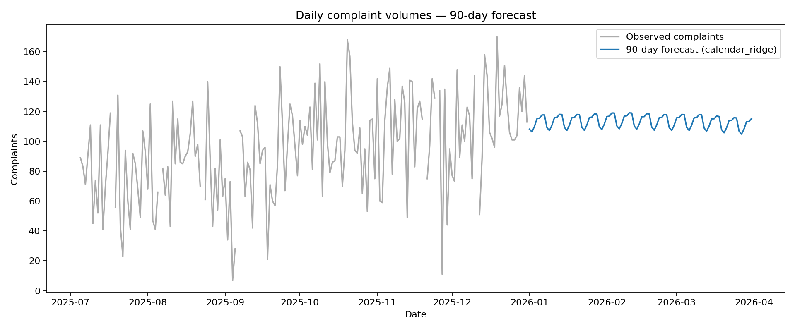

# Daily complaints: 90-day forecasting assessment

## Objective
Forecast daily complaint volumes for 90 calendar days after 31 December 2025 for operational capacity planning. This is a **multi-step forecast from one cut-off** — not a one-day-ahead prediction.

## Quick start
```bash
python -m venv .venv
# Windows: .venv\Scripts\activate
# macOS / Linux: source .venv/bin/activate
pip install -r requirements.txt
python forecast.py --input data/assessment.xlsx --output outputs
```

## Output files
- `outputs/forecast_90_days.csv`: dated, non-negative, whole-number complaint forecasts, 1 January to 31 March 2026.
- `outputs/model_comparison.csv`: average out-of-sample metrics across three 90-day folds.
- `outputs/backtest_metrics.csv`: fold-by-fold accuracy and temporal split dates.
- `outputs/forecast_chart.png`: recent observations and final forecast.
- `outputs/summary.json`: machine-readable data checks, selection and forecast total.

## Approach and rationale
1. Read the original workbook, validate the dates and create a daily time index. Absent rows and blank targets remain missing, **never zero**. Do not interpolate the target for fitting or test scoring.
2. Use only information available when the 90-day forecast is made. The supplied `centered_7d_mean` incorporates future target observations (look-ahead leakage), so it is excluded. Staffing, backlog, media mentions and channel mix are excluded because their **future actual values are not provided**; using them at validation time would make an unrealistic forecasting claim.
3. Compare an interpretable 28-day weekday-mean baseline against regularised calendar regression. The baseline captures recent level and weekly patterns. Ridge models weekday, smooth trend and yearly/monthly calendar harmonics. Both predict all 90 days in one shot without future observed targets.
4. Evaluate **three 90-day backtests**, using an expanding training window and the same forecast horizon as the actual task. Ignore missing actual targets within each test fold. Primary selection metric: **MAE** (easy to explain as typical daily volume error). RMSE highlights large misses; WAPE gives an operations-friendly relative-volume measure.
5. Choose the lowest mean backtest MAE and retrain using all available observations. Export the 90-day result. Counts are rounded and clipped at zero.

## Engineering judgement / limitations
- Future exogenous variables would require separate forecasts or agreed planning scenarios. The current solution prioritises validity over a misleading model with inaccessible future inputs.
- Calendar regression assumes broad trends and seasonality remain reasonably stable. The baseline adapts rapidly but may miss longer-term growth. Compare fold results before adopting a model.
- Bank holidays could improve a future iteration if a verified regional holiday calendar is available for both historical and forecast periods. The provided `bank_holiday_flag` is approximate and cannot be carried forward as actual observations.
- Anomalies, policy changes, or operational incidents could break historical patterns. Production use should include updated forecasts, monitoring, and uncertainty bands. A further enhancement would calibrate an empirical prediction interval from **out-of-sample 90-day residuals** rather than claiming that point forecasts are certain.
- This is a short, transparent assessment solution, not an end-to-end production service. For production: environment pinning, monitoring, and agreed capacity thresholds should be added. This repository includes core tests and a simple CI workflow.

## Interpretation for the hiring panel
The target is an operational **volume** measure, not service quality. MAE quantifies the typical number of complaints by which a daily forecast differs from the actual value. Teams can aggregate the exported daily forecast into weekly staffing demand and add a separately agreed service-level buffer. A 90-day horizon is materially harder than a one-day-ahead problem, so model selection is validated using the same horizon.

## Repository structure
```text
complaints-volume-forecasting/
├── .github/workflows/validate.yml  # Runs tests and rebuilds forecasts on each push
├── .gitignore
├── data/assessment.xlsx             # Supplied source dataset
├── forecast.py                      # Data checks, backtesting, selection, forecasting
├── outputs/                         # Reproducible outputs committed for easy review
│   ├── backtest_metrics.csv
│   ├── forecast_90_days.csv
│   ├── forecast_chart.png
│   ├── model_comparison.csv
│   └── summary.json
├── requirements.txt
├── tests/test_forecast.py           # Core unit tests
└── README.md
```

## Results at a glance
The selected calendar Ridge model achieved an average **MAE of 22.66 complaints/day** versus **25.88** for the recent-weekday baseline, across three separate 90-day backtests. Its 90-day point forecast totals **10,201 complaints**. These are historical validation results, **not** measures of accuracy on the future forecast period.



## Run automated checks
```bash
python -m unittest discover -s tests -v
```
The GitHub Actions workflow performs this validation, then reruns the complete forecasting script on every push and pull request. Output files are committed as an interview-friendly snapshot; the script remains the source of truth.

## Submission

Public GitHub repository: https://github.com/betht0901/complaints-volume-forecasting

To reproduce the results, install the dependencies and run `python forecast.py` from the repository root. See the quick-start instructions above.

Only publish the supplied workbook if its distribution is authorised by the assessment provider.
